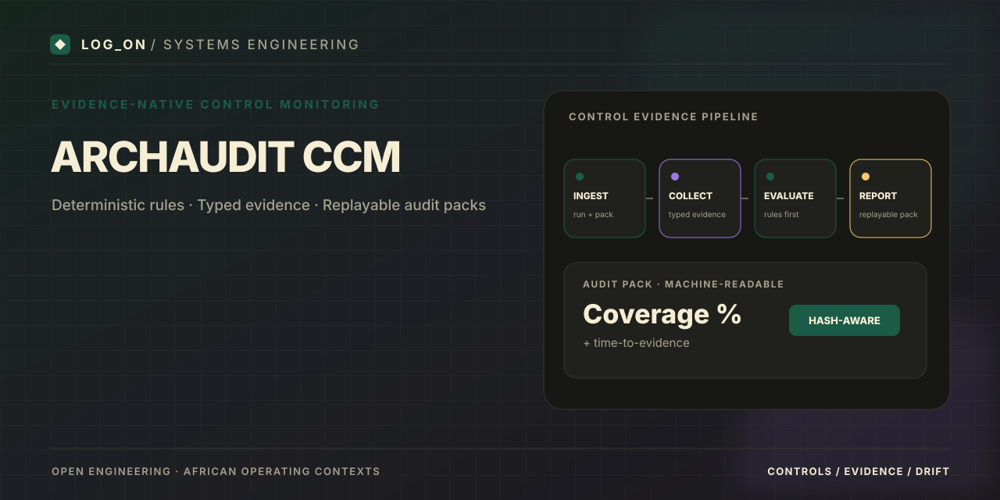
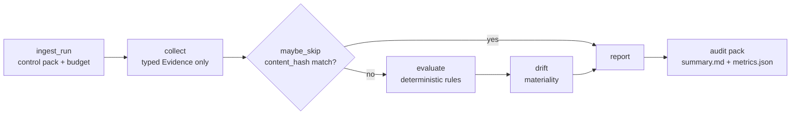

# ArchAudit CCM

<p align="center">
  
</p>

[]()
[]()
[]()

---

## What problem does this solve?

Control evidence goes stale. Teams cannot produce a measurable audit pack (Coverage % + Time-to-Evidence) without manual screenshot hunts. ArchAudit makes evidence the source of truth: adapters return typed Evidence only, deterministic rules evaluate first, and every run produces a fully replayable pack.

## Architecture



Aligned with ADR-001 v3: evidence-native contracts, governance plane phased, regional packs as data.

**Stack:** Python 3.11+ · Pydantic v2 · PyYAML · pytest  
Optional LangGraph-shaped orchestration. MCP-shaped tool envelopes.

## What is implemented

- Pipeline: ingest_run → collect → maybe_skip → evaluate → drift → report
- Pydantic v2 Evidence / Evaluation / Drift contracts
- YAML control pack (Access, Change, Logging)
- Content-hash skip gate
- Sample audit pack with Coverage % and Time-to-Evidence
- Full ADR trail and technical specification

## Quick start

```bash
pip install -r requirements.txt
make test
make run-sample
```

## Reproducible terminal demo

Run this from the repository root after installing the dependencies:

```bash
pip install -r requirements.txt
make run-sample
```

The pipeline writes its sample audit pack to `samples/audit_pack/`. Inspect the generated summary and metrics there; use `make test` to run the test suite.

To record a short terminal demo with [asciinema](https://asciinema.org/) and [agg](https://github.com/asciinema/agg):

```bash
asciinema rec docs/assets/archaudit-demo.cast
make run-sample
# Stop recording with Ctrl+D, then convert the cast to GIF with agg.
agg docs/assets/archaudit-demo.cast docs/assets/archaudit-demo.gif
```

Only publish the GIF after checking that the captured output is real, readable, and free of secrets. Keep the cast/GIF small; a static screenshot of the generated audit pack is also acceptable.


## Portfolio value

Evidence-first design for African GRC and security contexts. Deterministic rules over agent judgments. Machine-readable control packs.

## Limitations

Governance plane (exceptions, dual control) is Phase 2. Regional packs and OSCAL export are phased.

## Companion repositories

- [AgentBridge-Africa](https://github.com/Logonotobscurity/AgentBridge-Africa)
- [GigPilot](https://github.com/Logonotobscurity/GigPilot)

## Visual assets

- Branded README banner: `docs/assets/social-preview.svg`.
- Repository social preview: upload the matching 1280×640 PNG through **Settings → General → Social preview**. This setting is separate from the README banner.
- Optional terminal GIF: record the commands above locally, verify the output, then commit a compressed GIF if useful.
