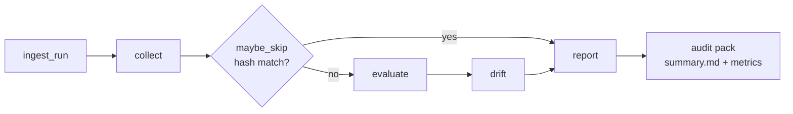

# ArchAudit CCM

<p align="center">
  <strong>Evidence-native Continuous Control Monitor</strong><br/>
  Deterministic-first · Typed contracts · Fully replayable
</p>

[]()
[]()
[]()
[]()

---

## What problem does this solve?

Control evidence goes stale. Teams cannot produce a measurable audit pack (Coverage % + Time-to-Evidence) without manual screenshot hunts. ArchAudit turns evidence collection into a deterministic, hash-aware, offline-replayable loop.

## Architecture



**Stack:** Python 3.11+ · Pydantic v2 · PyYAML · pytest  
Optional LangGraph-shaped orchestration. MCP-shaped tool envelopes.

## What is implemented

- Six-layer pipeline: Intake → Collection → Skip → Evaluation → Drift → Reporting
- Pydantic v2 contracts for Evidence, Evaluation, Drift
- YAML control pack (Access, Change, Logging families)
- Content-hash skip gate
- Sample audit pack with metrics
- ADR trail (v2 → v3) and technical specification

## Quick start

```bash
pip install -r requirements.txt
make test
make run-sample
```

## Demo

<!-- 
Record a CLI demo with asciinema:
  asciinema rec demo.cast
  # run make run-sample
  agg demo.cast demo.gif
Or for a web docs site later:
  npx screencli record <url> -p "Show audit pack generation and metrics"
-->

> Demo GIF coming soon. For now, run `make run-sample` and inspect `samples/audit_pack/`.

## Portfolio value

Demonstrates evidence-first design, deterministic rules over agent judgments, and machine-readable control packs suitable for African GRC and security engineering contexts.

## Limitations

Governance plane (exceptions, dual control) is Phase 2. Regional packs and OSCAL export are phased.

## Companion repositories

- [AgentBridge-Africa](https://github.com/Logonotobscurity/AgentBridge-Africa)
- [GigPilot](https://github.com/Logonotobscurity/GigPilot)

## Visual assets checklist

- [ ] Social preview image (1280×640 PNG/JPG < 1 MB) — repo Settings → Social preview (Socialify or custom)
- [ ] Demo GIF (600–800 px, 5–15 s, < 5 MB) of `make run-sample` (asciinema + agg recommended)
- [ ] Optional logo in `docs/assets/` (transparent PNG, works in dark/light)
- [ ] Architecture diagram static fallback if Mermaid is insufficient
