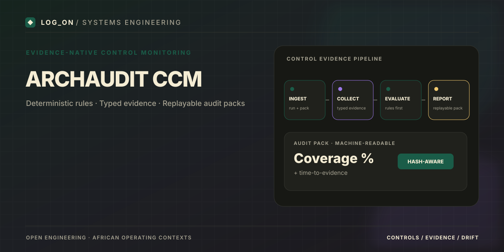
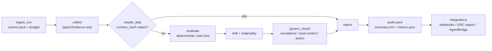

# ArchAudit CCM

<p align="center">
  
</p>

[]()
[]()
[]()

---

## Market Core Promise We Adopt

The 2026 Continuous Control Monitoring market promises one thing above all:

> **Always-on, audit-grade proof that controls are operating — plus the ability to act when they are not.**

ServiceNow, Cyber Sierra, Drata, Vanta, Scytale, Compyl and others deliver this through heavy platforms, large integration catalogs, and increasingly agentic interpretation + ticket/remediation loops.

ArchAudit adopts the same core promise and deliberately improves on the weaknesses those platforms still carry:

| Market strength we keep | Market weakness we attack |
|-------------------------|---------------------------|
| Continuous evidence collection | Evidence is often just “artifact exists”, not typed and replayable |
| Automated control testing | Evaluation is frequently opaque or fully agent-driven |
| Action on failure (tickets / remediation) | Action is tightly coupled to the vendor’s workflow engine |
| Multi-framework mapping | Almost no support for African / emerging-market operating realities |
| Broad integrations | Vendor lock-in and high cost of exit |

**ArchAudit’s refined promise:**

> Evidence-native Continuous Control Monitoring that produces measurable, fully replayable audit packs (Coverage % + Time-to-Evidence), evaluates with deterministic rules first, supports policy-gated action automation, and is designed from day one for African operating environments and clean integration into larger GRC or agentic delivery systems.

---

## What problem does this solve?

Control evidence goes stale. Teams still scramble for screenshots. Most CCM tools either:
- stay at “evidence collected” without proving the control is operating, or
- hand judgment to opaque agents, or
- lock the entire loop inside one expensive platform.

ArchAudit makes **typed Evidence the source of truth**, runs **deterministic rules first**, records every decision basis, and emits a **replayable audit pack**. Action automation (exceptions, dual-control, tickets, webhooks) is designed as an explicit, policy-gated plane — not a black-box agent.

---

## Architecture (realigned)



- **Evidence plane** — adapters return only typed Evidence (never judgments).
- **Evaluation plane** — deterministic rules are primary; any agent assistance is policy-gated and recorded as `decision_basis`.
- **Governance & Action plane** — exceptions, dual control, TTL, owner, and outbound actions (ticket, webhook, AgentBridge hand-off).
- **Integration plane** — first-class export and event surfaces so ArchAudit can feed ServiceNow, Drata-style platforms, or AgentBridge without becoming them.

Aligned with ADR-001 v3.1.

**Stack:** Python 3.11+ · Pydantic v2 · PyYAML · pytest  
Optional LangGraph-shaped orchestration · MCP-shaped tool envelopes · thin FastAPI surface.

---

## What is implemented (v3 slice)

- Pipeline skeleton: ingest → collect → maybe_skip → evaluate → drift → report
- Pydantic v2 Evidence / Evaluation / Drift contracts
- YAML control pack (Access, Change, Logging)
- Content-hash skip gate
- Sample audit pack with Coverage % and Time-to-Evidence
- Full ADR trail and technical specification

## Roadmap (realigned to market)

**Phase 2 — Governance + Action Automation (highest leverage)**
- `govern_check` node (exceptions, dual control, TTL, owner)
- Materiality thresholds from control pack
- Evidence hash chain / integrity on replay
- Outbound action hooks (webhook, ticket stub, AgentBridge event)
- Thin FastAPI `/runs` + auth stub
- Proper CI (pytest + schema validation)

**Phase 3 — Integrations + Regional Reality**
- First real adapters (GitHub, identity, simple cloud posture)
- Regional evidence packs (NG, KE) as pure data
- Event-driven collection option
- OSCAL export path
- Dashboard metrics surface

---

## Quick start

```bash
pip install -r requirements.txt
make test
make run-sample
```

The pipeline writes its sample audit pack to `samples/audit_pack/`.

---

## Why this is a better fit

- **Deterministic-first** protects against the non-determinism risk that pure agentic CCM introduces in regulated environments.
- **Typed, replayable evidence** directly answers the “trusted evidence” gap that analysts and boards are now demanding.
- **Action automation is explicit and policy-gated**, not hidden inside a vendor’s agent runtime.
- **Integration-first design** means ArchAudit can sit under or beside existing GRC platforms instead of forcing a rip-and-replace.
- **African operating context** (regional packs as data, low cloud-vendor assumptions) is currently unique in the category.

## Portfolio value (FDE / AI+GRC)

ArchAudit is the concrete proof artifact for **Gap 2 — AI + GRC / continuous control monitoring**.  
It complements AgentBridge Africa (production multi-agent reliability) and GigPilot (end-to-end FDE narrative).

## Companion repositories

- [AgentBridge-Africa](https://github.com/Logonotobscurity/AgentBridge-Africa)
- [GigPilot](https://github.com/Logonotobscurity/GigPilot)

## Visual assets

- Branded README banner: `docs/assets/social-preview.svg`.
- Repository social preview: upload the matching 1280×640 PNG through **Settings → General → Social preview**.
